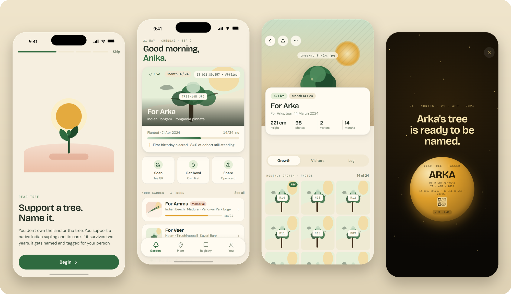

<div align="center">



# Dear Tree

**Plant a tree. Name it for someone you love.**

[**Try the live demo →**](https://shankaraa.github.io/dear-tree/)

[](LICENSE)

[](CONTRIBUTING.md)

</div>

---

## Why this exists

Most of us want to leave something good behind for the people we love. We usually do it with a gift, a photo, a post. They fade.

A tree doesn't. If it survives the first two years, it will probably outlive everyone who planted it.

Dear Tree is a simple idea: **you don't need to own land to own a tree.** You fund a sapling on public land, a local steward looks after it, and you follow it month by month. If it is still standing after 24 months, it gets a permanent tag with a name on it.

*For Arka, born 14 March 2024.*
*In memory of Lakshmi, 1948–2022.*
*For the 4B teachers.*

Each tree gets a public registry ID, so anyone walking past can scan it and read who it is for.

The point isn't the number of trees planted. It's the number that **survive**. That's why the whole app is built around the two-year journey instead of the moment you pay.

## Where it is now

This is an **early, clickable prototype**: real screens and real flows, with no backend yet. It's built as a design and product sketch that we want to turn into something real, together.

What you can click through today:

| | |
|---|---|
| **Onboarding** | The idea in four short screens |
| **Garden** | Your trees, their age, and how the rest of their cohort is doing |
| **Plant** | Choose a site, a species, who it's for, and a tier |
| **Tree page** | Timeline, steward check-ins, location, dedication |
| **Tag ceremony** | The day a tree makes it to 24 months |
| **Registry** | A public directory of every named tree |
| **Groups and CSR** | Schools, classes and companies planting together |

There is also a tweaks panel to switch light and dark mode and scrub a tree from month 1 to month 24.

## Run it locally

No install and no build. React and Babel are bundled in `vendor/`.

```bash
git clone https://github.com/Shankaraa/dear-tree.git
cd dear-tree
python -m http.server 8000
```

Open <http://localhost:8000>. You need the small server because the browser can't load the JSX files over `file://`.

## Come build it with us

This is open to anyone who cares about climate and wants to work on something real. **College students, first-time contributors, designers, ecologists, people who organise plantation drives on weekends: all welcome.** You don't need to be an expert. You need to be curious and willing to ship small things.

Some ways in:

- **Write code.** Pick an issue labelled [`good first issue`](https://github.com/Shankaraa/dear-tree/labels/good%20first%20issue).
- **Design.** Accessibility, illustrations, regional languages, the tag itself.
- **Know trees?** Help us get species, seasons and survival data right. This matters more than any feature.
- **Run a plantation group or NGO?** Tell us how stewardship actually works on the ground. Open a discussion.
- **Use it in a class or hackathon.** It's MIT licensed. Fork it, remix it, take it to your city.

Read [CONTRIBUTING.md](CONTRIBUTING.md) to get started. It's short.

## Where AI can genuinely help

We don't want "AI" as a sticker. These are problems where it can actually make trees survive:

- **Survival check from a photo.** A steward uploads a monthly photo, and a model flags stress, disease or a dead sapling early enough to replant.
- **Right tree, right place.** Recommend native species for a site using soil, rainfall and nearby survival data, rather than whatever is cheapest in the nursery.
- **Satellite canopy tracking.** Use open imagery (Sentinel-2) to verify that a planted site is actually getting greener over time.
- **Honest reporting.** Turn raw survival data into plain-language updates for families, and into audit-ready reports for CSR funders, without inflating anything.
- **Languages.** Dedications and steward updates in Tamil, Hindi, Kannada and beyond.

If you work on climate ML, remote sensing or computer vision, we would love your help scoping any of these. Start a discussion.

## Roadmap

- [x] Clickable prototype of the full journey
- [ ] Contributor-friendly build setup (Vite) instead of in-browser Babel
- [ ] Backend and public registry API
- [ ] Steward app: monthly photo check-ins
- [ ] QR / NFC tag scanning
- [ ] First pilot with a real plantation partner
- [ ] AI survival checks from steward photos

## Project layout

```
index.html          entry point
app.jsx             app shell and navigation
data.jsx            sample people, trees and planting sites (all fictional)
ui.jsx, icons.jsx   shared components
tokens.css          colours, type, spacing, light/dark
screens/            onboarding, garden, plant, ceremony, registry, tree-detail, profile
vendor/             React, ReactDOM, Babel
```

## License

[MIT](LICENSE). Use it, fork it, plant something.

All people, organisations and trees in the sample data are made up.
